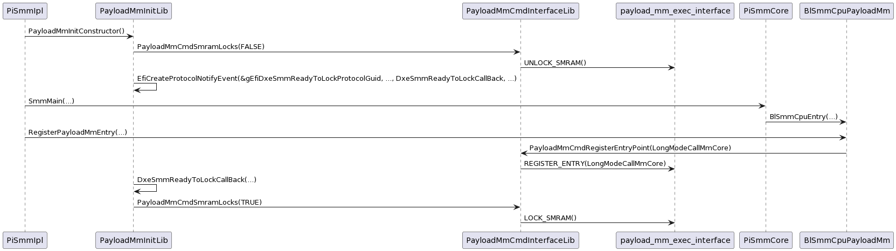
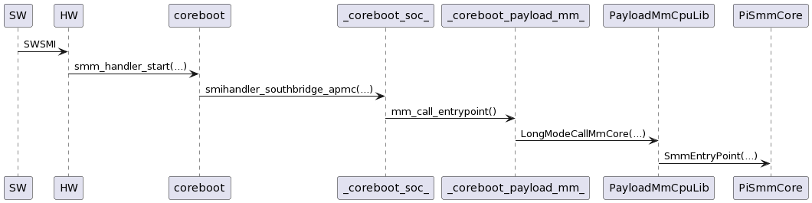

# Share SMM with payload

## Introduction

Payload MM is a new feature that enables a bootloader and payload to share the SMM environment. The objective is to allow the payload to install platform-specific handlers, while keeping the ownership, initialization and silicon-specific components in the bootloader, where they belong. An example use-case - and the primary one prepared for support at this time - is UEFI secure boot with authenticated variables at runtime in SMM.

A key objective of the payload MM design is to decouple the bootloader and payload, and avoid modifications to either of them. This should reduce the maintenance burden.

"**Payload** MM" is inaccurate, because other consumers are possible. **Naming options**:
- Bootloader MM
- Modular SMM
- (S)MM Modularis

**Open tasks**:
- Finalise code during review
- Consider using the MM supervisor, this requires enhancing the supervisor first.

**Open questions**:
- How to avoid SWSMI number conflict?
    - In practice, this may not be an issue. EDK2 uses `APM_CNT_NOOP_SMI` and its own communication buffers.

## Components

Bootloader:
- CBTABLEs (see "bootloader hands-off some data" below)
- MM Core support (see "bootloader implements the following SMI handler interface" and "S3 resume" below)

Payload:
- PayloadMmCmdInterfaceLib: Calls the bootloader’s SMI interface, consider as backend
- PayloadMmInitLib: Should be linked into payload MM IPL, consumes PayloadMmCmdInterfaceLib to unlock/lock SMRAM
- BlSmmCpuPayloadMm: Adapted from PiSmmCpuDxeSmm for our purposes. Installs payload MM into privileged environment
- PayloadMmCpuLib: Should be linked into BlSmmCpuPayloadMm, implements the bootloader-specific part of transferring execution and returning back (ABI and mode switch, as required)

## Initialisation

The bootloader will relocate SMM and install permanent handlers as usual. SMRAM should be closed, but the hardware left in a state where it can be unlocked again.

The bootloader hands-off some data:
- A subregion of SMRAM for the payload to use.
    - A page of this is reserved for payload MM purposes, see "S3 resume" below.
- The SWSMI number of the payload MM interface, necessary for initialisation, and the bootloader's own bitness, to determine if runtime mode switches are necessary.
- Use-case specific data. For instance, data about the SPI controller, used for enabling variable storage.

The bootloader implements the following SMI handler interface:
- **UNLOCK_SMRAM**: Unlock at least the payload MM subregion.
- **REGISTER_ENTRY(MmEntryPoint)**
- **LOCK_SMRAM**: Lock SMRAM, and don't open it again.

> [**!CAUTION**]
> For obvious security reasons, it is critical that the bootloader feature support is disabled when the payload support isn't present. To an attacker, this gives RWX control over SMRAM by design. Furthermore, note that this opens up the TCB and requires some trust in later stages of the boot process than typically expected (depending on silicon, **UNLOCK_SMRAM** may apply to the whole region. Option ROMs should either be avoided or constrained).

During initialisation, the payload shall first send the **UNLOCK_SMRAM** sub-command to the payload MM interface. Later, it must select an appropriate trampoline function for **REGISTER_ENTRY**, based on the bootloader's bitness. Finally, it must call **LOCK_SMRAM** again.

An example initialisation control flow (from payload MM IPL onwards) is below:

## Runtime

(TODO: The bootloader shall call payload MM in the bootloader's own native ABI/the System-V ABI), passing one argument, a `struct EFI_MM_ENTRY_CONTEXT *`. The bootloader calls in its native bitness, it is payload MM's responsibility to check and provide intermediate code to perform an ABI/mode switch, if required. Furthermore, the payload should not make assumptions that CPU features are enabled or not. For example, if FPU registers are required, the intermediate payload MM code must fxsave/fxrstor and enable these before entering the actual payload.

An example runtime control flow (from delivery of an APMC to the HW) is below:

## S3 resume

Payload MM implementations remain in-place through S3 resumes.

On S3 resume, the bootloader will reinitialise SMM. Memory contents are preserved, so the payload MM subregion, at least, will preserve its state. Some bootloaders, however, will reinitialise entirely. To handle this, the payload MM entrypoint is also saved in the first page of the payload MM subregion, in a struct shared between the bootloader and the payload. On S3 resume, the bootloader checks this shared area for the correct header, then restores the payload MM entrypoint address.
